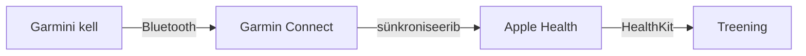

# Treening – Apple Fitnessi stiilis rakendus Garmini kellale

iPhone'i rakendus (SwiftUI, iOS 17+), mis näitab Garmini kellaga kogutud andmeid
samamoodi nagu Apple Fitness: aktiivsusrõngad, nädala ülevaade, treeningud
pulsigraafikuga ja trendid.

## Kuidas andmed Garmini kellast rakendusse jõuavad



Garmin Connect kirjutab Apple Healthi sammud, aktiivsed kalorid, treeningud ja pulsi.
Rakendus loeb neid HealthKiti kaudu (ainult lugemine, midagi ei kirjutata).

## Funktsioonid

| Vaade | Sisu |
|---|---|
| **Kokkuvõte** | Kolm rõngast (Liikumine kcal, Treening min, Sammud), nädala rõngad E–P, vahemaa, puhkepulss, liikumisseeria, viimased treeningud |
| **Treeningud** | Kuude kaupa nimekiri; detailvaates kestus, vahemaa, tempo/kiirus, kalorid, pulsigraafik ja pulsitsoonid |
| **Trendid** | 28 päeva tulpdiagramm koos eesmärgijoonega, viimase 7 päeva keskmine vs eelnevad 28 päeva |
| **Seaded** | Päevased eesmärgid, maksimaalne pulss, näidisandmed, Garmini ühendamise juhend |

**Erinevused Apple Fitnessist:** Garmin ei kirjuta Apple Healthi Apple Watchi
„Seismise” tunde ega treeningminuteid, seega

- kolmas rõngas on **Sammud** (Garmini kellade põhinäitaja);
- treeningminutid arvutatakse kella salvestatud treeningutest (kattuvused loetakse üks kord).

## Käivitamine

Vaja on Maci ja Xcode 15+.

```bash
brew install xcodegen
cd GarminFitness
xcodegen generate
open GarminFitness.xcodeproj
```

1. Vali Xcode'is sihtmärgi **GarminFitness** alt *Signing & Capabilities* → oma Team
   (ja muuda vajadusel `PRODUCT_BUNDLE_IDENTIFIER` failis `project.yml`).
2. **Simulaatoris** lülituvad näidisandmed automaatselt sisse.
3. **iPhone'is** loe andmeid päriselt:
   - Garmin Connect → *Rohkem → Seaded → Ühendatud rakendused → Apple Health* → luba kõik andmetüübid;
   - käivita rakendus ja luba tervise andmete lugemine;
   - seadetes lülita „Näidisandmed” välja.

Testid: `⌘U` Xcode'is või

```bash
xcodebuild test -scheme GarminFitness -destination 'platform=iOS Simulator,name=iPhone 15'
```

## Struktuur

```
GarminFitness/
├── project.yml                  XcodeGeni projekt
├── GarminFitness/
│   ├── App/                     rakenduse sisenemispunkt ja vahekaardid
│   ├── Models/                  andmemudelid ja ActivityMath (puhtad arvutused)
│   ├── Services/                HealthKitProvider (päris andmed), DemoProvider (näidised)
│   ├── Store/                   FitnessStore – olek, eesmärgid, tuletatud näitajad
│   └── Views/                   rõngad, kokkuvõte, treeningud, trendid, seaded
└── GarminFitnessTests/          ühiktestid
```

## Edasiarendus

- **Otseühendus kellaga:** [Garmin Connect IQ Mobile SDK](https://developer.garmin.com/connect-iq/core-topics/mobile-sdk-for-ios/)
  võimaldab vahetada sõnumeid oma Connect IQ kellarakendusega (nt reaalajas pulss).
- **Garmin Health API:** Garmini enda näitajad (Body Battery, stress, intensiivsusminutid) –
  nõuab Garmini arendajaprogrammi heakskiitu.
- Vidinad (WidgetKit) rõngastega avaekraanil, auhinnad ja eesmärkide teavitused.
